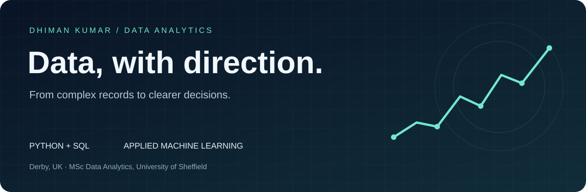

<a href="https://github.com/dimmy98/Developing-Evaluating-ML-for-HealthCare"><strong>Explore my work</strong></a> &nbsp; / &nbsp; <a href="https://linkedin.com/in/dhiman-kumar">LinkedIn</a> &nbsp; / &nbsp; <a href="mailto:dhimankumar98@gmail.com">Get in touch</a>

## Turning data into something useful

I'm Dhiman, a data analyst in Derby, UK. My background spans software engineering, operational analytics and an MSc in Data Analytics at the University of Sheffield.

At Rolls-Royce Aerospace, through Expleo Group, I work with maintenance data, SQL reporting and Python automation. The part I enjoy most is working through messy records until the result is something someone can trust and use.

My academic projects took that curiosity into healthcare: comparing regression models for insurance charges and exploring deep learning for harmful brain activity classification.

## Two projects. Two different data challenges.

<table>
<tr>
<td width="50%" valign="top">

### 01 / Healthcare billing prediction

**Tabular data · Regression · Model evaluation**

How well can simple and ensemble models explain variation in medical insurance charges?

My MSc dissertation compared linear regression, a tuned decision tree and gradient boosting. The dashboard walks through the workflow, model comparisons and feature analysis.

**Reported best test R²: 0.8641**

[Explore the repository →](https://github.com/dimmy98/Developing-Evaluating-ML-for-HealthCare)

[Open the interactive dashboard →](https://dimmy98.github.io/Developing-Evaluating-ML-for-HealthCare/)

[Read the case study →](case-studies/healthcare.md)

</td>
<td width="50%" valign="top">

### 02 / Harmful brain activity

**EEG · Deep learning · Team research**

How can spectrograms and neural networks help classify harmful brain activity?

A University of Sheffield team project for the HMS Kaggle competition, exploring EfficientNet models, different input representations and two-stage training.

**Training notebooks + inference code**

[Explore the team repository →](https://github.com/supinfl/UoS_HBAC/tree/baseline)

[Read the case study →](case-studies/brain-activity.md)

</td>
</tr>
</table>

## Where my experience connects

| Focus | What that means in my work | Tools |
| :--- | :--- | :--- |
| **Reliable data** | Validate records, investigate inconsistencies and prepare data for reporting | Python, SQL, pandas, NumPy |
| **Useful reporting** | Make operational information easier to understand and act on | Power BI, Matplotlib, Jupyter |
| **Applied ML** | Compare baselines, examine errors and explain evaluation limits | scikit-learn, PyTorch, TensorFlow |
| **Data workflows** | Connect extraction, transformation and reporting steps | Azure, Azure Synapse, Spark, Git |

## The path so far

**Data Analyst · Rolls-Royce Aerospace, via Expleo Group**  
Maintenance data, validation, SQL reporting and Python automation.

**Data Engineer Apprentice · Makutu.io**  
Power BI dashboards and data workflows with Python and Azure Synapse.

**AI / ML & Speech Intern · University of Sheffield**  
Speech-model evaluation with the SUPERB benchmark and s3prl.

**Intermediate Software Engineer · DXC Technology**  
Backup and recovery, VMware environments and operational support.

**MSc Data Analytics · University of Sheffield · 2024 · Merit**

## What I'd like to explore next

Predictive maintenance, better data validation and machine learning that holds up beyond a single experiment. I’m particularly interested in the point where a useful analysis becomes a dependable workflow.

If you work with engineering data, healthcare ML or practical analytics, I'd be happy to [connect](https://linkedin.com/in/dhiman-kumar).

---

Good data work starts with a clear question — and ends with something useful.

